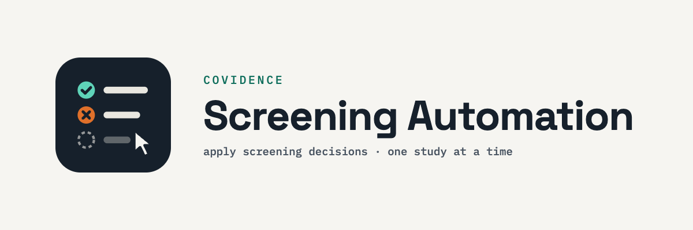

Automates and documents five stages of a [Covidence](https://www.covidence.org/)
systematic-review project, one study at a time: applying pre-computed title/abstract screening
decisions, retrieving + attaching full-text PDFs for studies that passed title/abstract
screening, casting the full-text Include/Exclude vote (with its exclusion reason) once a study
has been read and decided at full text — all three via browser automation (Playwright) —
building the review's Data Extraction and Quality Assessment templates in Covidence itself (a
one-time UI configuration, documented here as a reproducible spec rather than a script), and the
20%-sample duplicate-extraction calibration check that followed.

**Context:** built for a systematic review on breastfeeding vs. formula feeding and the
infant gut microbiome (PROSPERO CRD420261485879, Covidence review 818465,
*"microbiome_methodologies"*). The decisions in `search-results-2026-10/screening_decisions.csv`
and `full-text/full_text_screening_decisions_2026-10-09.csv` were produced by reading each
record's title/abstract or full text against this review's own PECO eligibility criteria —
not by an LLM API call at vote-time, and not by guessing. This repo captures each review step
and the automation (or spec, where there's no automation to capture) that applies it, including
the bugs found and fixed along the way, so the process is reproducible and the failure modes
are documented.

This README covers all five stages: **title/abstract screening** (below), **full-text
retrieval + upload** (see [Full-text retrieval and upload](#full-text-retrieval-and-upload)),
**full-text review + voting** (see
[Full-text review and voting](#full-text-review-and-voting)), **extraction template setup**
(see [Extraction template setup](#extraction-template-setup)), and the **calibration agreement
check** (see [Calibration agreement check](#calibration-agreement-check)).

---

## Contents

| File | Purpose |
|---|---|
| `apply_screening_decisions.py` | Main script. Logs into Covidence, reads the screening queue, and casts the correct vote (Include → Yes, Exclude → No, Maybe → Maybe) for each study, one at a time. |
| `debug_queue.py` | Read-only diagnostic. Logs in, opens the queue, and prints the raw text/HTML of the first few study cards — casts **no votes**. Use this if Covidence changes its page layout and the main script starts misbehaving again (see [Known issues](#known-issues--troubleshooting-history) below). |
| `search-results-2026-10/screening_decisions.csv` | The screening results: one row per PMID, with columns `pmid,decision,justification`. |
| `retrieve_remaining_full_texts.py` | Finds free copies of missing full texts via Unpaywall + Crossref. See [Full-text retrieval and upload](#full-text-retrieval-and-upload). |
| `download_blocked_oa_pdfs.py` | Retries open-access PDFs that a publisher's bot-check blocked, via a real browser. |
| `upload_full_texts.py` | Attaches locally-held full-text PDFs to the matching Covidence record. |
| `full-text/retrieval_status_<date>.csv` | Per-record status: already available locally vs. still needs retrieving. |
| `full-text/remaining_retrieval_categorized_<date>.csv` | Still-missing records, categorized by retrieval route. |
| `vote_fulltext_decisions.py` | Casts the full-text Include/Exclude vote (with exclusion reason) for studies already decided at full text. See [Full-text review and voting](#full-text-review-and-voting). |
| `full-text/full_text_screening_decisions_2026-10-09.csv` | The full-text screening results: one row per Covidence study number, columns `covidence_number,doi,title,decision,exclusion_reason,justification`. |
| `extraction_template_spec.md` | Literal field-by-field and domain-by-domain record of the Data Extraction and Quality Assessment templates as built in Covidence. See [Extraction template setup](#extraction-template-setup). |
| `Infant_Microbiome_Codebook.docx` | Human-readable extraction instructions (not just field names) matching the spec above — the document an extractor actually reads while working a study. Also published as an artifact; link in [Extraction template setup](#extraction-template-setup). |
| `extraction/calibration_agreement_comparison.md` | Full field-by-field, study-by-study inter-rater agreement analysis for the 20% duplicate-extraction calibration sample (23 studies). See [Calibration agreement check](#calibration-agreement-check). |
| `extraction/Calibration_Agreement_Report.docx` | Formatted report version of the same analysis, for documentation/manuscript use. |
| `fill_quality_assessment.py` | Casts Quality Assessment (ROBINS-I / RoB 2 + the 5-domain microbiome-methods checklist) judgements into Covidence from a locally-drafted Section J block. See [Quality assessment at volume](#quality-assessment-at-volume). |
| `extraction/_manifest.csv` | covidence_number → doi/title/source-markdown-path lookup for all 111 included studies; used to search Covidence by the paper's actual title rather than an author-year label. |
| `extraction/_volume_progress.csv` | Per-study tracker for the 88 post-calibration studies: assigned reviewer, and whether Section J is drafted / filled into Covidence. |
| `extraction/volume_qa_draft.md` | Philip's 44 Section J blocks (44/44 drafted and filled). |
| `extraction/volume_qa_draft_alaa.md` | Alaa's 44 Section J blocks (43/44 drafted and filled — see [Known issues #2](#2-a-cross-reviewer-in-progress-lock-blocks-a-second-reviewers-assessment)). |
| `requirements.txt` | Python dependencies. |
| `.env.example` | Template for your local credentials file. |
| `.gitignore` | Keeps `.env`, virtual environments, logs, and downloaded PDFs out of version control. |

---

## Background: how `screening_decisions.csv` was produced

- **Source set:** a PubMed search executed via NCBI E-utilities, exported as MEDLINE text,
  producing **2,109 deduplicated records**. This is the exact file that was imported into
  Covidence review 818465 — the two were diffed PMID-for-PMID and confirmed identical
  (2,109/2,109 match, zero on either side) before any voting was attempted.
- **Screening method:** each record's full title and abstract (not just the title) was read
  against the review's settled PECO criteria:
  - Healthy term infants (≥37 weeks gestation), 0–12 months at stool sampling — preterm/NICU
    populations excluded by design.
  - Exposure/comparison must be breastfeeding vs. formula (or vs. mixed/combination feeding)
    as an *actual analyzed group comparison* — not merely an adjustment covariate.
  - Outcome must be gut/stool **bacterial** composition assessed via sequencing (16S rRNA or
    shotgun metagenomics) — this is a hard gate. Function (metabolomic, PICRUSt-predicted,
    targeted assay, shotgun) is a secondary, non-gating outcome but does not substitute for
    the sequencing-based composition requirement. qPCR-only, FISH-only, culture-only, or
    DGGE/microarray-only methods fail this gate even when they report feeding-mode
    differences.
  - Non-stool specimens (breast milk, colostrum, oral, nasopharyngeal, skin, vaginal,
    blood/serum/urine), animal models, in vitro/ex vivo/organoid/bioreactor studies, bacterial
    strain/genomic/enzyme characterization studies with no infant cohort, virome/mycobiome-only
    outcomes, disease-population studies where the primary comparison is by disease rather than
    feeding mode, narrative reviews/commentaries/conference-abstract-only records, and
    protocols with no results yet reported were excluded.
- **Decision values:**
  - `Include` — meets all criteria.
  - `Exclude` — fails one or more criteria (reason given in `justification`).
  - `Maybe` — genuinely ambiguous (e.g., abstract doesn't state the sequencing method,
    unclear whether a real feeding-mode comparison is reported, missing abstract text).
    These are deliberately **not** force-resolved to Include/Exclude; they're meant to
    surface for full-text human review, which is exactly what voting "Maybe" in Covidence
    does.
- **Final tallies (2,109 total):** 163 `Include`, 1,922 `Exclude`, 24 `Maybe`.

---

## Prerequisites

- Python 3 (any recent 3.x)
- A Covidence account with voting permission on the target review
- macOS/Linux/Windows with a terminal — no other software needed; Playwright installs its
  own Chromium browser (see below)

---

## Setup
cd into your working directory
```bash
# 1. (recommended) create and activate a virtual environment
python3 -m venv .venv
source .venv/bin/activate

# 2. install Python dependencies
pip install -r requirements.txt

# 3. download the Chromium browser Playwright drives (one-time, ~100-200MB)
pip install playwright
playwright install chromium

# 4. create your local credentials file
cp .env.example (rename to .env)
```

Open `.env` in a text editor and fill in your **own** real Covidence login:

```
#covidence password and username
COVID_ID=you@example.com
COVID_PASSWORD=your_real_covidence_password
```

`.env` is loaded automatically via `python-dotenv` and is excluded from git by
`.gitignore` — never commit it, never share it.

---

## Usage

### 1. Test run first — always

Before trusting it with the full queue, sanity-check on a handful of studies:

```bash
python3 apply_screening_decisions.py --limit 10
```

A visible Chromium window opens, logs in, goes to the review's screening queue, and votes
on the first 10 studies at the top of the queue. Watch the terminal output — each line
should show a **real, 7–8 digit PMID** next to a sensible title and decision, e.g.:

```
2026-10-01 16:21:26,722 INFO PMID 27446009: Exclude ('Flow Cytometric and 16S Sequencing
Methodologies for Monitoring the Physiological Status of the Microbiome in Powdered Infant
Formula Production.')
```

Then **cross-check a few of those in the Covidence UI directly** to confirm the votes
landed on the right studies before proceeding.

### 2. Full run

```bash
python3 apply_screening_decisions.py
```

With no `--limit`, it processes up to 10,000 studies (effectively "all of them"),
reloading the page before every single vote. This is deliberately slow and one-at-a-time
— see [How it works](#how-it-works) for why. For ~2,109 decisions expect this to take
several hours; let it run.

To run without a visible browser window:

```bash
#update the script to have your file path: 
python3 apply_screening_decisions.py --headless
```

---

## How it works

`apply_screening_decisions.py` loads all rows of the decisions CSV into memory, then loops:

1. Reload the screening queue URL (`.../review_studies/screen?filter=vote_required_from`).
2. Grab the study card currently at the top of the queue.
3. Extract its PMID and title from the page.
4. Look up the PMID in the loaded decisions.
   - **Found:** click the matching vote button (Yes/No/Maybe) and log it.
   - **Not found:** stop immediately without voting (see
     [`no_decision` behavior](#3-no_decision-now-stops-instead-of-guessing) below).
5. Repeat from step 1.

**Why reload before every single vote, one at a time?** Covidence's screening list recycles
DOM nodes between items. Voting on several queued studies without a fresh reload in between
produced unreliable results during testing — votes silently not saving, or landing on the
wrong study. A full page reload immediately before each individual interaction was the only
pattern that worked reliably.

---

## Known issues / troubleshooting history

This section exists because this exact script already failed once in a subtle way during
initial testing, and the fix depended on evidence gathered via `debug_queue.py` rather than
guessing. If Covidence changes its page markup in the future and voting starts behaving
oddly again, **repeat this process** rather than patching blindly:

1. Run `python3 debug_queue.py` (read-only, casts no votes) and inspect the printed card
   text/HTML.
2. Confirm by hand what the real PMID/title look like in the output.
3. Only then adjust the selectors/regex in `apply_screening_decisions.py`.

### 1. PMID extraction bug (found and fixed 2026-10-01)

**Symptom:** every vote in a 10-study test run logged as `PMID 10`, even though 10 different
papers with 10 different titles were clearly being voted on in sequence.

**Root cause:** the original extraction logic queried for a CSS class (`.ref-ids`) that
didn't contain the real reference number on the live page — it was silently matching some
unrelated element elsewhere in the DOM that happened to read "10". Because the function
returned a non-null value, it never triggered an error; it just silently fed the wrong key
into the decisions lookup, found no match, and voted the safe-default of "Maybe" on every
study — which, at the time, cast genuinely incorrect votes on real studies in the live
review.

**How it was actually found:** `debug_queue.py` was written to log in, print the full
visible text and outer HTML of the first few study cards, and cast no votes. The real PMID
turned out to be rendered as plain visible text on every card, e.g.:

```
DOI:
10.3389/fmicb.2016.00968
•
Ref ID: 27446009
```

**The fix:** `extract_ref_id()` now does a simple regex search (`Ref ID:\s*(\d+)`) against
the card's full visible text (`card.inner_text()`), instead of relying on a CSS class name
that may or may not exist on the current version of Covidence's page. This was verified
against two different real records (cross-checked the "Ref ID" number against the actual
PMID, title, and pre-computed decision for both) before being trusted.

**Cleanup required:** because 10 studies were mis-voted "Maybe" before this was caught, the
9 unique affected PMIDs had to be manually corrected back to their proper decision directly
in the Covidence UI. This is why the test-run-first step above exists — **always test on a
small `--limit` and spot-check in Covidence before running the full batch.**

### 2. Harmless double-vote on the first study right after login

**Symptom:** the very first study processed in a fresh run sometimes gets voted twice in a
row (same PMID, same correct decision, back-to-back).

**Likely cause:** a timing issue immediately after login/page-transition — the first
vote-click occasionally doesn't register before the page reloads, so the same top-of-queue
item is picked up again on the next loop iteration and voted again.

**Impact:** none. Both votes land on the identical, correct value — Covidence just keeps
the current vote. It costs a few wasted seconds at the start of a run and is not worth
engineering around.

### 3. `no_decision` now stops instead of guessing

Earlier behavior (now removed) was: if a study's PMID had no matching row in the decisions
CSV, vote "Maybe" as a "safe default" and keep going. **This is what let the extraction bug
above cause real damage** — it masked the underlying problem instead of surfacing it.

Current behavior: if a PMID has no pre-computed decision, the script **stops immediately
without voting**, logs a clear warning with the PMID and title, and must be resolved by a
human (decide if it's in scope, screen it and add it to the CSV, or vote it directly in
Covidence) before being restarted. This should not happen in normal operation — see
[Scope verification](#scope-verification) below — but if it does, don't restart blindly;
investigate the logged PMID first.

### Scope verification

Before the first full run, the PMID set in the raw PubMed MEDLINE export that was imported
into Covidence was diffed against the PMID set covered by `screening_decisions.csv` and
confirmed to be an **exact match** (2,109 in each, identical set, zero on either side). If
this script or CSV is ever reused against an updated or re-exported search, **redo this
check first** — don't assume the sets still match. A short Python snippet for this:

```python
import json, csv

# PMIDs from the raw MEDLINE (.txt) export, format: "PMID- 12345678"
raw_pmids = set()
with open("path/to/raw_export.txt") as f:
    for line in f:
        if line.startswith("PMID-"):
            raw_pmids.add(line.split("-", 1)[1].strip())

# PMIDs covered by the decisions file
decided_pmids = set()
with open("search-results-2026-10/screening_decisions.csv", newline="") as f:
    for row in csv.DictReader(f):
        decided_pmids.add(row["pmid"])

print("In raw export but not decided:", len(raw_pmids - decided_pmids))
print("Decided but not in raw export:", len(decided_pmids - raw_pmids))
print("Exact match:", raw_pmids == decided_pmids)
```

Any non-zero count on either line means something needs to be screened or reconciled
*before* running the script against that queue.

---

## Monitoring / resuming

- Every run appends to `covidence_apply.log` in this folder — check it for a final summary
  line (`Finished. Processed N studies this run.`) and for any `WARNING`/`ERROR` lines.
- The script always pulls whatever is currently at the top of Covidence's "vote required"
  queue. If you stop it (Ctrl+C) and rerun later, it just continues from wherever the queue
  is now — there's no separate resume flag or state file to manage.
- Keep an eye on it periodically rather than walking away entirely, in case Covidence shows
  a session timeout, CAPTCHA, or other interactive prompt the script can't handle on its own.

---

## After the run completes

1. Check `covidence_apply.log` for the final summary and scan for any `no_decision` or
   `extract_failed` entries.
2. Spot-check a handful of votes directly in the Covidence UI against
   `screening_decisions.csv` to confirm everything landed as expected.
3. For any `Maybe` votes, follow up with full-text review as normal — they were flagged as
   ambiguous on purpose, not resolved automatically.

---

## Security notes

- **Never commit `.env`.** It's excluded via `.gitignore`; only `.env.example` (with
  placeholder values) is tracked.
- `apply_screening_decisions.py` contains the Covidence review URL
  (`.../reviews/818465/...`). This is not a secret, but it is specific to this project's
  review — update `SCREENING_URL` if reusing this script for a different Covidence review.
- Virtual environment directories (`venv/`, `.venv/`, etc.) and the runtime log
  (`covidence_apply.log`) are also excluded from version control — they're local artifacts,
  not part of the reproducible process.

---

## CSV schema

`search-results-2026-10/screening_decisions.csv`:

| Column | Description |
|---|---|
| `pmid` | PubMed ID of the record |
| `decision` | One of `Include`, `Exclude`, `Maybe` |
| `justification` | One-sentence reason for the decision |

---

## Branding assets

`assets/` contains the project's icon set:

| File | Size | Used for |
|---|---|---|
| `readme-header.png` | 1200×400 | The header image at the top of this README. |
| `icon.png` | 512×512 | Square icon/favicon, for reuse wherever a small square mark is needed. |
| `social-preview.png` | 1280×640 | GitHub's link-unfurl / social-media preview image. |

GitHub doesn't let a repo set its own social preview image via a file in the repo or via
git push — it has to be uploaded through the web UI:

1. Go to the repo's **Settings → General**.
2. Scroll to **Social preview**.
3. Click **Edit**, upload `assets/social-preview.png`, and save.

---

## Full-text retrieval and upload

Three scripts that pick up where `apply_screening_decisions.py` leaves off: once a study is
voted **Include** at title/abstract, Covidence moves it into **Full Text Review**, where it
needs an actual PDF attached before a human can screen it at full text. This part of the
toolkit finds those PDFs (legally, via open-access lookups) and attaches them to the right
Covidence record, the same "automate the repetitive part, never fabricate the judgment part"
approach as the title/abstract tool.

**Context:** same review as the rest of this repo (Covidence review 818465,
*"microbiome_methodologies"*). As of the run this was built for, 235 studies had reached
Full Text Review and 148 of them had no PDF attached yet in Covidence.

### The pipeline, in order

```
1. retrieve_remaining_full_texts.py   -- find free copies via Unpaywall + Crossref
2. download_blocked_oa_pdfs.py        -- retry the ones a publisher's bot-check blocked
3. upload_full_texts.py               -- attach the downloaded PDFs to the right Covidence record
```

Each stage writes a CSV the next stage reads, so they can be re-run independently once a
PDF set has been built up — you don't have to re-run the whole pipeline to pick up a new
batch of manually-sourced PDFs; see [Re-running with a different batch](#re-running-with-a-different-batch)
below.

### Files in this stage

| File | Purpose |
|---|---|
| `retrieve_remaining_full_texts.py` | For every study missing full text: resolves a DOI if one isn't already known (via a Crossref bibliographic title search), looks the DOI up in [Unpaywall](https://unpaywall.org/), and downloads the PDF if Unpaywall has a direct link. Categorizes everything else (no direct link, not open access, no DOI at all) into a report CSV for manual follow-up. |
| `download_blocked_oa_pdfs.py` | Retries the subset that Unpaywall confirmed as open access but whose direct download got an HTTP 403/429 from the publisher (see [Known issues](#known-issues--troubleshooting-history-full-text-pipeline)) — using a real Playwright-driven Chromium browser instead of a raw HTTP request. |
| `upload_full_texts.py` | Logs into Covidence, searches by title for each record with a locally-held PDF, and uploads it through the "Upload full text" dialog. |
| `full-text/retrieval_status_<date>.csv` | Per-record status after the local-file cross-check: `have_locally_needs_upload`, `still_needs_retrieval`, or `still_needs_retrieval_no_doi`. Input to `upload_full_texts.py`. |
| `full-text/remaining_retrieval_categorized_<date>.csv` | Output of `retrieve_remaining_full_texts.py` — one row per still-missing record, categorized by retrieval route (see [CSV schemas](#csv-schemas)). |

PDFs themselves are **not** committed to this repo (see [What's not here](#whats-not-here)).

### Prerequisites (full-text stage)

Same as [Prerequisites](#prerequisites) above: Python 3, `pip install -r requirements.txt`,
`playwright install chromium`, and a `.env` with real Covidence credentials. No additional
dependencies — `retrieve_remaining_full_texts.py` uses only the standard library (`urllib`,
`json`, `csv`) for its Unpaywall/Crossref calls.

### Usage (full-text stage)

#### 1. Find what's retrievable

```bash
python3 retrieve_remaining_full_texts.py
```

Reads `full-text/retrieval_status_<date>.csv` for rows still needing a PDF, resolves a DOI
via Crossref for any that don't have one, checks Unpaywall, and downloads anything with a
direct PDF link into `full-text/open-access-<date>/`. Prints a category breakdown at the
end — see [CSV schemas](#csv-schemas) for what each category means.

#### 2. Retry the bot-blocked ones

```bash
python3 download_blocked_oa_pdfs.py
```

Takes the `open_access_pdf_link_failed` rows from step 1's report and retries each one
through a real headless Chromium session instead of a raw HTTP request. **Re-run it 2–3
times** if the count doesn't converge the first time — Playwright's download-event capture
has a race condition on slower redirect chains (increase the `expect_download(timeout=...)`
value in the script if a specific publisher consistently needs longer; see
[Known issues](#known-issues--troubleshooting-history-full-text-pipeline)).

#### 3. Upload to Covidence — test first

```bash
python3 upload_full_texts.py --csv full-text/retrieval_status_<date>.csv --limit 1 --headless
```

Then check that one record in the Covidence UI before trusting it with the rest.

#### 4. Upload to Covidence — full run

```bash
python3 upload_full_texts.py --csv full-text/retrieval_status_<date>.csv --headless
```

Expect roughly 25–40 seconds per record (title search, open, upload, confirm). Drop
`--headless` to watch it work.

#### Re-running with a different batch

`upload_full_texts.py` takes `--csv` so it can target any status CSV with
`have_locally_needs_upload` rows — not just the original one. Build a fresh batch file
(same five columns as the schema below) whenever a new set of PDFs is ready, and point the
script at it:

```bash
python3 upload_full_texts.py --csv full-text/retrieval_status_<date>_batch2.csv --headless
```

This is also how manually-sourced PDFs get uploaded — e.g. the "landing page only" and
truly-closed records from step 1's report, retrieved by hand from GWU institutional access
or a publisher's page directly: save the PDF, add a row for it to a batch CSV, run the
script.

### How it works (full-text stage)

#### `retrieve_remaining_full_texts.py`

For each still-missing record:

1. If there's no DOI yet, search Crossref's bibliographic-match endpoint
   (`api.crossref.org/works?query.bibliographic=<title>`) and accept the top hit only if its
   title closely matches the target (a 60-character prefix-overlap check) — this guards
   against confidently attaching the wrong DOI to a title that happens to rank first.
2. Query Unpaywall (`api.unpaywall.org/v2/<doi>?email=...`) for `best_oa_location`.
3. If there's a direct `url_for_pdf`, download it and **validate the first four bytes are
   `%PDF`** before saving — some "PDF" links actually serve an HTML interstitial, and saving
   that without checking would silently corrupt the full-text record with garbage.
4. Categorize everything else by what Unpaywall returned (OA-but-landing-page-only,
   confirmed-not-OA, or lookup failure) into the report CSV.

#### `download_blocked_oa_pdfs.py`

Same idea as step 3 above, but via `page.goto()` in a real Chromium browser (not raw
`urllib`) — a genuine browser TLS/HTTP fingerprint gets past simple bot-score checks that a
bare HTTP client doesn't. Two response shapes are handled:

- A normal page loads: check it's actually a PDF (`resp.body()` starts with `%PDF`), not an
  HTML block page.
- Chrome itself intercepts the response as a **file download** (common for publisher
  "direct PDF" links): this makes `page.goto()` raise rather than return normally, so the
  download has to be caught via `page.expect_download()` *around* the `goto()` call, with
  the resulting `Download` object saved via `.save_as()`.

#### `upload_full_texts.py`

1. Loads every `have_locally_needs_upload` row from the given CSV.
2. For each: searches Covidence by title
   (`/review_studies/search?search%5Bterm%5D=<title>`).
3. Opens the result — see [search page behavior](#1-two-different-pages-depending-on-result-count)
   below for why this isn't as simple as "click the first link."
4. Dismisses the "Access your library's full texts" (LibKey) promo modal if Covidence shows
   it on that record.
5. Clicks "Upload full text", attaches the local PDF via `set_input_files`, waits for it to
   register, clicks "Done".

### Known issues / troubleshooting history (full-text pipeline)

Same philosophy as the [main Known issues section](#known-issues--troubleshooting-history)
above: these were found by actually looking at what the live page returned, not guessed at.
If Covidence changes its markup and this starts misbehaving, repeat the same process — dump
the real page content/URL and compare against what the code assumes, rather than patching
blindly.

#### 1. Two different pages depending on result count

**Symptom:** every multi-result title search was logging `NO_RESULTS`, even for titles that
were visibly present in Covidence when searched by hand.

**Root cause:** Covidence's search behaves differently depending on how many studies match:

- **Exactly one match:** the search skips straight to that study's own page — the URL
  becomes `.../review_studies/select?filter=all&id=NNNN`.
- **Zero or multiple matches:** it lands on `.../review_studies/search?...`, a results-list
  page where each result is a plain `<a href="/reviews/818465/review_studies/{id}">` — note,
  critically, **no `select?` in that href**. That query string only appears *after* you
  click through to a specific study.

The original selector (`main a[href*="/review_studies/select?"]`) could only ever match the
single-result auto-redirect case. On every multi-result page it matched zero elements,
which the code read as "no results" — when in reality the right study was usually sitting
right there in the list, just under a different link shape.

**The fix:** check `page.url` after navigating. If it already contains `/review_studies/select`,
the single-match redirect happened — done. Otherwise, scan the result links
(`main a[href*="/review_studies/"]`) for one whose text contains the *exact* target title
(normalized: lowercased, whitespace-collapsed) rather than assuming the first result is
correct — multi-result pages are often full of loosely related matches (shared common words
like "infant", "microbiome", "gut"), and the real target is not reliably first.

#### 2. Covidence's search has a hard 150-character limit

**Symptom:** a handful of titles consistently returned zero results, even after fix #1 —
verified by hand in the Covidence UI that the exact same title string, searched directly,
returned real results.

**Root cause:** Covidence silently truncates/rejects queries over 150 characters, showing
`"Search is limited to 150 characters. Please shorten your query for more accurate
results."` on the results page — easy to miss if you're only checking the result count, not
reading the page banner.

**The fix:** the search *query* is truncated to 150 characters at a word boundary, but the
**full, untruncated title** is still what gets exact-matched against the result list — a
shortened query only needs to surface the right record among the results, it doesn't need
to uniquely identify it by itself.

#### 3. A same-paper, same-authors record duplicated in Covidence

**Symptom:** one title (a prebiotics/probiotics starter-formula RCT) kept coming back
`ambiguous` no matter what — two results, identical title text, so no exact-match logic
could tell them apart.

**Root cause:** not a script bug — Covidence genuinely had two separate study entries for
the same paper (`#9839 "Radke 2016"` and `#1720 "Radke 2017"`), most likely an epub-vs-print
publication-year mismatch between two source databases that Covidence's own deduplication
didn't catch.

**Resolution:** uploaded the same PDF to both entries (both genuinely need one, regardless
of the duplicate), and flagged the pair for a reviewer to merge via Covidence's own
"Duplicate" action — **this is a review-integrity decision a script shouldn't make
unilaterally.** If `upload_full_texts.py` logs `ambiguous` for a search that returns results
with genuinely identical titles, check for this before assuming it's a script bug.

#### 4. Publisher bot-protection blocks raw HTTP downloads (Akamai WAF)

**Symptom:** `retrieve_remaining_full_texts.py` reported `open_access_pdf_link_failed` for
roughly a third of all Unpaywall-confirmed-OA links — all `HTTP 403 Forbidden`, even though
Unpaywall had independently confirmed each one was freely downloadable.

**Root cause:** the response body for the 403s was an Akamai edge-server block page
(`errors.edgesuite.net`), not a real access-denial from the publisher. Several publishers
(JAMA, MDPI, ASM, Taylor & Francis, Wiley, and others) sit behind bot-protection that blocks
non-browser HTTP clients — even for content that is genuinely, legitimately open access.

**The fix (partial):** re-fetching through a real Playwright Chromium browser
(`download_blocked_oa_pdfs.py`) — a genuine browser TLS/HTTP fingerprint gets past the
simpler checks. This recovered roughly 40% of the blocked set. The remainder resisted even
a real headless browser, almost certainly because the WAF additionally checks for
automation markers (e.g. `navigator.webdriver`). **Deliberately not pursued further** —
getting past that would mean stealth/anti-detection techniques (fingerprint spoofing,
disabling automation flags), which starts to cross from "fetch something I have a legitimate
right to read" into "evade a specific protection mechanism," even for content that's
legitimately free. Those remaining records are better opened in an actual logged-in
browser by a human — faster and more appropriate than engineering around a WAF.

#### 5. `page.goto()` raises instead of returning when Chrome intercepts a download

**Symptom:** even after the WAF-bypass fix above, a meaningful chunk of "blocked" records
turned out not to be blocked at all — Chrome was successfully starting the file download,
but the script logged every one of them as `failed: Page.goto: Download is starting`.

**Root cause:** several publishers' "direct PDF" links (`journals.asm.org`,
`tandfonline.com`, `onlinelibrary.wiley.com`, `cell.com`, `jacionline.org`, `cmaj.ca`, and
others) respond in a way that makes Chrome treat the navigation as a **file download**
rather than a page load. Playwright surfaces this by raising an exception out of
`page.goto()` — the original code treated any exception there as a genuine failure.

**The fix:** wrap the `goto()` call in `page.expect_download(timeout=...)` *before* calling
it, catch the resulting `Download` object, and save it via `.save_as()` — then validate the
saved file's first four bytes are `%PDF` before trusting it, same as every other download
path in this toolkit. A short timeout (5s) missed some slower redirect chains; 20s cleared
nearly all of them, with one or two needing a second run to land (see
[step 2 above](#2-retry-the-bot-blocked-ones)). If a specific publisher's downloads are
consistently still missed at 20s, raise the timeout further rather than assume it's
genuinely blocked.

### What's not here

The downloaded PDFs themselves (`full-text/open-access-<date>/*.pdf`) are **not** committed
to this repo. This toolkit documents and automates *how* to legally retrieve and attach
them — it doesn't redistribute copies of the papers, even the open-access ones. Re-running
`retrieve_remaining_full_texts.py` + `download_blocked_oa_pdfs.py` against the status CSVs
regenerates the same files.

### CSV schemas

`full-text/retrieval_status_<date>.csv` — per-record status after cross-checking against
locally-held files:

| Column | Description |
|---|---|
| `status` | `have_locally_needs_upload`, `still_needs_retrieval`, or `still_needs_retrieval_no_doi` |
| `doi` | Normalized DOI (lowercased, no trailing period), or blank |
| `title` | Record title |
| `first_author` | First author surname, if known |
| `year` | Publication year, if known |
| `local_pdf_path` | Path to the matching local file (only set when `status` is `have_locally_needs_upload`) |

`full-text/remaining_retrieval_categorized_<date>.csv` — output of
`retrieve_remaining_full_texts.py`:

| Column | Description |
|---|---|
| `title`, `doi` | As above |
| `doi_resolved_via_crossref` | `True` if the DOI wasn't already known and had to be resolved via a Crossref title search |
| `category` | `downloaded_open_access`, `open_access_pdf_link_failed`, `open_access_landing_page_only`, `closed_needs_institutional_access_or_ill`, `no_doi_found_needs_manual_lookup`, or `unpaywall_lookup_failed` |
| `pdf_or_landing_url` | The PDF or landing-page URL Unpaywall returned, if any |
| `notes` | Error detail for failed categories |

### Security notes (full-text stage)

Same as [Security notes](#security-notes) above: never commit `.env`; the Covidence review
URL embedded in these scripts is project-specific, not secret; virtual environments and
runtime logs (`upload_full_texts.log`, `retrieve_remaining_full_texts.log`,
`download_blocked_oa_pdfs.log`) are excluded from version control.

---

## Full-text review and voting

Picks up where the retrieval/upload stage leaves off: once a study has a PDF attached in
Covidence, a human (here: careful reading against this review's own exclusion criteria)
decides Include or Exclude at full text — but *casting* that decision as an actual vote in
Covidence's UI is still a repetitive, one-record-at-a-time task. `vote_fulltext_decisions.py`
automates that casting step; it never decides eligibility itself.

**Context:** same review (818465, *"microbiome_methodologies"*). The 10 exclusion-reason
categories it selects from are the ones already configured in Covidence's own "Full Text
Exclusion Reasons" list for this review — the script matches by exact text, it doesn't invent
reasons.

### Files in this stage

| File | Purpose |
|---|---|
| `vote_fulltext_decisions.py` | Main script. Logs in, finds each decided record by title (falling back to an exact covidence-number match when title alone is ambiguous — see [Known issues #3](#3-duplicate-title-record-pairs-cant-be-disambiguated-by-title-alone)), and casts Include, or Exclude with the matching reason. |
| `full-text/full_text_screening_decisions_2026-10-09.csv` | The decisions: one row per Covidence study number. Grows over time as more full-text-stage records get decided — the script always reads however many rows the file currently has, nothing is hardcoded. |

### Prerequisites (full-text review stage)

Same as [Prerequisites](#prerequisites) above, plus: Covidence voting permission specifically
at the **Full Text Review** stage (distinct from title/abstract voting permission).

### Usage (full-text review stage)

#### 1. Dry run first — zero risk, clicks nothing

```bash
python3 vote_fulltext_decisions.py --dry-run
```

Walks every row, confirms each resolves to the expected covidence_number, and logs anything
that doesn't (`no_results` / `ambiguous` / `cn_mismatch`) without touching the review. These
get skipped, not voted — safe to leave a handful for manual follow-up.

#### 2. One real Include vote

```bash
python3 vote_fulltext_decisions.py --limit 1
```

Check that record in Covidence afterward.

#### 3. One real Exclude vote — proves the exclusion-reason picker

```bash
python3 vote_fulltext_decisions.py --limit 1 --only-exclude
```

Check the exclusion reason landed correctly — see
[Known issues #2](#2-the-exclusion-reason-picker-is-a-native-select-not-a-clickable-list)
below for why this path needed its own fix.

#### 4. Full run

```bash
python3 vote_fulltext_decisions.py
```

Stops itself on anything it isn't sure about rather than guessing. If it stops partway,
re-run the same command — it re-searches fresh every time, not by position, so already-cast
votes are detected and skipped rather than re-cast (see
[Known issues #4](#4-already-voted-detection-has-to-happen-before-every-click-not-just-on-failure)).

### Multi-reviewer usage

Covidence tracks each reviewer's vote on a study separately. A second reviewer can run this
same script against the same decisions CSV to cast *their own* independent vote — it does not
overwrite or conflict with a first reviewer's vote, as long as the decisions agree.

```bash
python3 vote_fulltext_decisions.py --env-file .env.alaa --dry-run
python3 vote_fulltext_decisions.py --env-file .env.alaa --limit 1
python3 vote_fulltext_decisions.py --env-file .env.alaa
```

Create `.env.alaa` (or any name) the same way as `.env`, with that reviewer's own Covidence
login — never edit someone else's `.env` in a shared checkout; a stale credentials file
silently running under the wrong identity is exactly the kind of mistake this project has
already made once before (misattributed full-text uploads from an `.env` that pointed at the
wrong account for a period).

### How it works (full-text review stage)

For each row in the decisions CSV:

1. Search Covidence by title. Two outcomes:
   - Exactly one match: Covidence redirects straight to that study's page.
   - Multiple (or zero) matches: lands on a results list; scan it for a link whose **exact
     covidence_number** (`#1720`, `#9839`, etc. — the same number already in the decisions
     CSV) matches, falling back to exact-title matching only if the number isn't found.
2. Confirm the landed study's own covidence_number matches what was expected — if not, stop
   and flag it (`cn_mismatch`) rather than voting on the wrong record.
3. Check whether *this reviewer* has already voted this record, and what they voted. Matches
   the CSV's decision → skip, logged, no click. Differs → stop, flagged for a human.
4. Not yet voted: click **Include**, or click **Exclude** and then select the matching
   exclusion reason from the picker.
5. Save a screenshot + the page's full text to `vote_fulltext_logs/` after every real vote —
   so a wrong vote is always independently checkable afterward, not just trusted because the
   script logged success.

### Known issues / troubleshooting history (full-text review pipeline)

Same philosophy as the other stages' Known issues sections: these were found by looking at
what the live page actually returned (via saved diagnostics, or deliberately reading the
accessibility tree), not guessed at or patched blindly.

#### 1. A CSS substring selector silently double-counted every single match as "ambiguous"

**Symptom:** a full dry-run rehearsal reported dozens of `ambiguous -- landed on select page
but card count is 2 (expected 1)` results — including for titles independently confirmed, by
hand, to have exactly one match in Covidence.

**Root cause:** the card selector used an attribute *substring* match
(`[class*="StudyListItem-module__card"]`), which also matches the card's own nested child
wrapper, `...StudyListItem-module__cardContent` — whose class name happens to **start with**
the same substring. A genuinely single-match page was rendering one real card plus its own
child element, both satisfying the substring selector, so `len(cards) == 2` on every single
case, not just the real ambiguous ones.

**The fix:** switched to an exact class-*token* match (CSS `~=` rather than `*=`):
`[class~="webpack-pages-StudyList-StudyListItem-StudyListItem-module__card"]`. Verified
directly afterward: a known single-match page now correctly reports 1 card, and the
multi-result queue page correctly reports its real count (25, not 50).

#### 2. The exclusion-reason picker is a native `<select>`, not a clickable list

**Symptom:** the very first real Exclude vote failed with `Locator.click: Element is not
visible`, pointing at an `<option>` element whose text matched the right exclusion reason —
the code had *found* the right option, but couldn't click it.

**Root cause:** Covidence's reason picker renders as a plain HTML `<select>` (each
`<option>`'s value **and** visible text is the full criterion string — short label plus its
parenthetical description). `<option>` elements inside a `<select>` aren't independently
clickable the way a button or a styled dropdown item is.

**The fix:** find the `<select>` containing a matching `<option>` and call Playwright's
`select_option(label=..., force=True)` on the **select**, not `.click()` on the option.
Confirmed against a real vote: the log recorded `select_option matched 'No
breastfed-vs-formula-fed comparison (feeding mode not rep...'` and the exclusion reason showed
correctly in Covidence afterward.

#### 3. Duplicate-title record pairs can't be disambiguated by title alone

**Symptom:** a handful of titles consistently came back `ambiguous -- multiple
normalized-title matches`, even on retry — all for records already known (from the full-text
retrieval stage's [own duplicate-record issue](#3-a-same-paper-same-authors-record-duplicated-in-covidence))
to exist twice in Covidence under two different study numbers with identical or
near-identical titles (e.g. `#1720`/`#9839`).

**Root cause:** matching on normalized title text can't tell two identically-titled records
apart — there's no single "right" link to click by title alone.

**The fix:** each result-list link's text already starts with its own `#<number> — Name Year`,
exactly like a single-record page does. Since the target covidence_number is already known
(it's the row being processed), matching on that number directly — rather than on title text —
resolves the pair cleanly. Title-text matching is kept only as a fallback for the (so far
unseen) case where the expected number genuinely isn't present in a given result page.

#### 4. Already-voted detection has to happen *before* every click, not just on failure

**Symptom:** re-running the full batch (e.g. after fixing bug #1 or #2) made a row that was
already correctly voted in an earlier run fail with "could not find a UI element matching
reason... after clicking Exclude."

**Root cause:** clicking "Exclude" again on a record that's *already* voted Exclude is a
no-op from Covidence's point of view (nothing changes, so no fresh reason-picker ever
appears) — but the button carrying the current vote's own label changes, from plain
`"Include"`/`"Exclude"` to `"Change vote to include"` (shown when the current vote is
Exclude) or `"Change vote to exclude"` (shown when it's Include). The original code's
button-matching logic still found and clicked "Exclude" on the relabeled card, expecting a
reason picker that was never going to reappear.

**The fix:** before attempting any click, check the card for a `"Change vote to X"` label. If
found, that tells you the *current* vote (the opposite of whatever "X" is) — compare it
against the CSV's decision: match → log "already voted, skipping" and move on at zero cost;
mismatch → stop and flag it (`vote_conflict`) for a human, since overwriting an existing vote —
possibly cast by a different reviewer — is not a decision a script should make silently. This
also makes the script naturally safe to re-run after it stops partway through: it re-checks
every row fresh rather than assuming position in the file means anything.

#### 5. A tight loop fetching link text one element at a time made one row take 15+ minutes

**Symptom:** most rows resolved in under a minute, but a handful took 15–20 minutes each with
no errors and nothing logged in between — long enough to look like a hang, but the run always
eventually continued on its own.

**Root cause:** a loosely-matching title (lots of common words like "infant", "gut",
"microbiome") can pull back dozens-to-hundreds of loosely-related results from Covidence's
search. The result-scanning loop called `.nth(i).inner_text()` once per result, each a
separate round-trip to the browser — fine for a handful of results, very slow for a hundred.

**The fix:** `locator.all_inner_texts()` fetches every matching element's text in a single
batched call instead of N separate ones. Same matching logic, same result — just one
round-trip instead of up to a hundred.

### What's not here

The converted full-text markdown and the underlying PDFs are **not** committed to this repo,
same reasoning as the [full-text retrieval stage](#what-not-here) above — this toolkit
documents and automates the review/voting *process*, it doesn't redistribute the papers
themselves.

### CSV schema (full-text review stage)

`full-text/full_text_screening_decisions_2026-10-09.csv`:

| Column | Description |
|---|---|
| `covidence_number` | The study's own Covidence reference number (e.g. `#1720`), as shown on its card |
| `doi` | DOI, where known |
| `title` | Record title |
| `decision` | `Include` or `Exclude` |
| `exclusion_reason` | One of the 10 reasons configured in Covidence's own Full Text Exclusion Reasons list, exact text, blank for `Include` rows |
| `justification` | The specific evidence from the full text supporting the decision |

### Security notes (full-text review stage)

Same as [Security notes](#security-notes) above, plus: when more than one reviewer uses this
script against the same project checkout, each reviewer's credentials belong in their **own**
named file (e.g. `.env.alaa`), passed via `--env-file` — never share or overwrite one
reviewer's `.env` with another's. `vote_fulltext_decisions.log` and `vote_fulltext_logs/`
(per-vote screenshots) are runtime artifacts excluded from version control, same as the other
stages' logs.

---

## Extraction template setup

Picks up where full-text review leaves off: once all 233 full-text-stage records are decided
(111 Include, 122 Exclude, 0 remaining), the 111 included studies need a Data Extraction
template and a Quality Assessment template before anyone can start pulling data out of them.
Unlike the three stages above, this one has no repeatable script — it's a one-time template
*configuration*, done by hand in Covidence's own template editor via browser automation. What's
captured here instead of a script is a literal spec of what was built, so the template is
reconstructable or auditable without re-deriving it from conversation history.

**Context:** same review (818465, *"microbiome_methodologies"*). Built 15 Oct 2026.

### Files in this stage

| File | Purpose |
|---|---|
| `extraction_template_spec.md` | Field-by-field and domain-by-domain record of exactly what was configured: every custom field added to the Data Extraction template's Methods/Population/Interventions/Outcomes sections, and all 17 Quality Assessment domains with their judgement scales. |
| `Infant_Microbiome_Codebook.docx` | The field-by-field *instructions* (not just names) an extractor actually works from — what each field means, how to record it, and the review's standing conventions (`NOT REPORTED` for anything a study doesn't state, 20%-duplicate-extraction-then-verify). Also published as an artifact: https://claude.ai/code/artifact/8e611129-8251-461b-84be-245e35421faf |

### What was built

Covidence's Extraction 1 template type (not Extraction 2) — chosen because the review has a
defined comparator structure (breastfed vs. formula-fed vs. mixed/combination feeding) in
every included study, even though synthesis is narrative/vote-counting, not meta-analytic.
Extraction 1 explicitly supports qualitative result capture, not only numeric pooling, so the
narrative-synthesis choice doesn't disqualify it.

**Data Extraction Template** — 5 sections, full breakdown in `extraction_template_spec.md`:
Identification (unchanged defaults), Methods (6 custom fields, including the review's own
study-design classification — see Known issue #2 below), Population (13 custom fields,
including the 4-part race/ethnicity/ancestry construct), Interventions (3 feeding-mode groups
with verbatim-definition/classification/ascertainment detail fields replacing Covidence's
drug-trial Dose/Frequency defaults), Outcomes (9 outcomes, all set to Qualitative result type:
alpha/beta diversity, 5 named taxa individually, other differentially abundant taxa,
functional outcomes).

**Quality Assessment Template** — custom (Covidence's only built-in preset is Cochrane RoB1;
neither RoB 2 nor ROBINS-I is offered as a preset), 17 domains: 5 RoB 2 domains for RCTs
(Low/Some concerns/High), 7 ROBINS-I domains for observational studies (Low/Moderate/Serious/
Critical/No information), and 5 microbiome-methods checklist domains applying to every study
regardless of design (Yes/No/Not reported). The checklist isn't a convenience add-on —
`protocol.md`'s Risk of bias paragraph specifies it directly, assessed with the same
dual-reviewer-plus-adjudication rigor as RoB 2/ROBINS-I, added to close a gap the live
PROSPERO record (CRD420261485879) already claimed was covered.

### How this stage was done

No script — built directly in Covidence's template editor via browser automation (click,
type, verify via screenshot), the same way a human would, just faster and logged. For each
field: add it, type the name (controlled vocabulary embedded in the label text, since
Covidence's "Additional data" fields have no native dropdown/checkbox type), verify via
screenshot, move to the next. For Quality Assessment domains: add one, set its name and
judgement scale, then duplicate it for the next domain sharing that scale (all 5 RoB 2 domains
share Low/Some concerns/High; all 7 ROBINS-I domains and all 5 checklist domains likewise share
their own scale) — duplicating and renaming is faster and less error-prone than typing each
judgement option from scratch per domain.

### Known issues / gotchas found building this

#### 1. "Additional data" fields don't auto-save — nothing persists until Publish is clicked

**Symptom:** after building out Methods, Population, Interventions, and Outcomes in one
sitting, attempting to navigate away triggered a browser "Leave site?" unsaved-changes
warning. Opening the same template fresh in a second tab (a genuine server round-trip, not
cached state) showed Methods/Population's custom fields reverted to empty and
Interventions/Outcomes reverted to "Set Up" (unconfigured) — none of it had actually reached
the server.

**Root cause:** Covidence's template editor holds field-level edits in client-side state only;
there is no per-field autosave on blur, contrary to how most inline-editable UIs behave.
**Publish template** is the only commit action for the template *structure* itself (distinct
from per-study extraction data, which does autosave once extraction begins).

**The fix:** click Publish template to commit, confirmed via the same fresh-tab check
afterward (all fields present, "Published less than a minute ago by Philip" shown). Worth
remembering for any future template edit: changes sit in memory, unprotected, until published.

#### 2. The built-in "Study design" field is fixed, not editable, and has no cross-sectional option

**Symptom:** planned to edit Covidence's default Study design dropdown to the review's own six
design categories (including cross-sectional, needed for the RoB-tool branch decision).
Clicking its info icon opened a static list, not an editable options editor.

**Root cause:** the built-in Study design field in Extraction 1's Methods section is a fixed
system field — its option list (Randomised controlled trial / Case-control study / Cluster
RCT / Controlled interrupted time series / Historically controlled trial / Prospective cohort
study / Retrospective cohort study / Other) is not configurable, and it has no cross-sectional
option at all.

**The fix:** added a separate custom field, "Study design — review classification, governs RoB
tool," carrying the review's own exact six categories, and left the built-in field checked but
not authoritative. Documented in `extraction_template_spec.md` and the codebook so extractors
know which field actually decides the RoB 2/ROBINS-I branch.

### What's not here

No PDFs, no extracted data, no actual RoB/checklist judgements — this stage is template
*setup* only. 111 included studies are ready for extraction; 0 extracted as of 15 Oct 2026. The
per-outcome result-table columns (e.g. a custom "Direction of effect" column carrying the
review's four-way higher-in-breastfed/higher-in-formula-fed/no-difference/not-estimable scale)
also aren't built out yet — worth doing before extraction starts at volume.

## Calibration agreement check

Picks up where [Extraction template setup](#extraction-template-setup) leaves off: once the
templates were published, the review's own protocol (duplicate-extract a 20% sample, then
single-extraction-with-verification for the rest) called for an actual calibration run before
extracting the remaining 80% of the 111 included studies at volume. This stage is that run.

**Context:** same review (818465, *"microbiome_methodologies"*). 20%-sample extraction and
agreement analysis done 15–16 Oct 2026.

### Files in this stage

| File | Purpose |
|---|---|
| `extraction/calibration_agreement_comparison.md` | The full analysis: a per-field summary table (34 fields × 23 studies, 782 field-comparisons), the overall agreement rate, 13 individually-quoted notable disagreements (5 of them verified directly against each paper's own source text/tables), cross-field patterns, and a dedicated cross-check of a two-paper (VDAART) cross-study contradiction both extractors independently caught. |
| `extraction/Calibration_Agreement_Report.docx` | The same content as a formatted Word report (title page, Methods, Results, Appendix with per-study FA/PA/DA grids), intended for the eventual manuscript's Methods/Data Extraction subsection and as a standalone audit artifact. |

### What was done

Two reviewers ("Philip" and "Alaa") independently extracted the same random 20% sample (23 of
111 included studies, seed 20261016) against the full 34-field extraction spec. Alaa's pass was
genuinely blind — produced with no access to Philip's draft, using a fresh agent session with no
shared context, not merely a second read of the same work. Each of the 782 resulting
field-comparisons was scored Full agreement / Partial agreement / Disagreement / Not comparable.
**Result: 98.6% full-or-partial agreement (711 full + 60 partial of 782), 90.9% full agreement.**
A sample of the disagreements was then independently verified against the underlying source
papers (not against either draft's self-description), finding 5 genuine, source-confirmable
factual errors: 4 in Philip's draft, 1 in Alaa's — an asymmetry worth noting for a future
verification pass, but not grounds to prefer either extractor's reading by default.

This exercise is also what prompted two protocol-level refinements already adopted ahead of
full-corpus extraction and documented in `protocol.md` / `Infant_Microbiome_Codebook.docx`: a
dedicated 3-way scale for beta diversity (it didn't fit the 4-way direction-of-effect scale used
for scalar outcomes), and a standing rule for classifying "hybrid-design" studies (RCT between
formula arms + non-randomized breastfed reference group) by the comparison actually extracted,
not the paper's own registered randomization.

### Known issues / gotchas found during this stage

#### 1. A background comparison agent's closing summary contradicted its own detailed write-up

**Symptom:** the agent that produced the comparison file reported back, in its final
task-notification summary, that "every source-verified factual error... was in Philip's draft,
never Alaa's." The file's own Batch 3 finding (the #1236 beta-diversity item) explicitly
concludes the opposite for that one item — Alaa's characterization was the one that didn't hold
up, with Philip's reading verified correct.

**Root cause:** the agent's one-line closing summary over-generalized from the pattern in most
of its findings (4 of 5) without re-checking against its own itemized detail before reporting
back — a case of the summary drifting from the work, not the work itself being wrong.

**Fix:** always read an agent's actual output file before repeating its closing summary as
fact, even when the summary sounds confident and specific. The file's own `extraction/
calibration_agreement_comparison.md` content (the per-finding detail in Section 4, and the
corrected Section 5 point 4) is the source of truth; it was corrected in place before this report
and this README section were written, rather than trusting the chat-relayed summary.

#### 2. `soffice` (LibreOffice) is not installed in this environment

**Symptom:** the standard docx-skill verification step (`soffice --headless --convert-to pdf`,
then render to images) fails with `FileNotFoundError: soffice`.

**Fix:** fall back to `pandoc -t markdown file.docx` to extract and spot-check the full text
content (headings present, corrected findings present verbatim, table structure intact, per-study
appendix complete) instead of a visual render. Confirms correctness of content and structure, not
pixel-level layout — note this limitation if a future stage needs guaranteed visual fidelity.

### Security notes

No credentials, API keys, or PHI in these files — this stage is pure text analysis and document
generation from already-screened, already-extracted study data.

---

## Quality assessment at volume

Picks up where [Extraction template setup](#extraction-template-setup) and the [Calibration
agreement check](#calibration-agreement-check) leave off: with the Quality Assessment template
published and the 20% calibration sample's own Quality Assessment already done by the same
mechanism below, the remaining 88 included studies (111 total minus the 23-study calibration
sample) still needed their Quality Assessment (Section J: Risk of bias) cast into Covidence.
As with the full-text voting stage, *forming* each judgement is the reasoning step — done once
per study by reading the paper's actual Methods/Results text — and *casting* it into
Covidence's click-heavy, screenshot-verified UI is the repetitive step this script automates.

**Context:** same review (818465, *"microbiome_methodologies"*). The 88 studies were split
into two 44-study halves (Philip, Alaa) and worked in small batches (2 studies at a time) from
15 Oct through 27 Oct 2026.

### Files in this stage

| File | Purpose |
|---|---|
| `fill_quality_assessment.py` | Main script. Parses a study's `### J. Risk of bias` markdown block, resolves its Covidence study id by title search, and casts each domain's judgement + reasoning via the Quality Assessment form's Playwright DOM. |
| `extraction/_manifest.csv` | covidence_number → doi/title/source-markdown-path for all 111 included studies. Used to search Covidence by the paper's *actual* title, not the local draft's author-year heading label (see [Known issues #1](#1-searching-by-author-year-heading-label-instead-of-actual-title-is-unreliable)). |
| `extraction/_volume_progress.csv` | Tracker: one row per study, with `assigned_to` (Philip/Alaa), `section_j_drafted`, and `qa_in_covidence`, updated after each successful fill. |
| `extraction/volume_qa_draft.md` | Philip's 44 Section J blocks. 44/44 drafted and filled. |
| `extraction/volume_qa_draft_alaa.md` | Alaa's 44 Section J blocks. 44/44 drafted and filled — the last one, #1988, was briefly blocked by a cross-reviewer lock, see [Known issues #2](#2-a-cross-reviewer-in-progress-lock-blocks-a-second-reviewers-assessment). |

### Section J format

Each study gets a `## #<covidence_number> — <short label> (<country>)` heading, a short
italic design-context paragraph (noting anything that affects which RoB tool applies or how a
domain should be read — e.g. a "hybrid design" where an RCT between formula arms is paired
with a non-randomized breastfed reference group, classified by the comparison actually
extracted rather than the paper's own registered randomization), then a `### J. Risk of bias`
block with a provenance note, a "RoB tool applicable" field, a 5-or-7-row ROBINS-I/RoB 2 table,
and the 5-row microbiome-methods checklist table (sample collection & storage / DNA extraction
/ sequencing depth / contamination controls / compositional-data handling, each Yes/No/Not
reported) that applies to every study regardless of design. `parse_section_j()` extracts
`(domain, judgment, reasoning)` triples from the two tables by matching each row's middle
column against the review's fixed vocabulary of 10 judgment words (`Low`/`Moderate`/.../`Not
reported`) — this is what lets one regex safely skip header/separator rows and the *other*
tool's left-blank table (every study uses exactly one of ROBINS-I/RoB 2, never both) without
tracking which sub-table a row came from.

### Prerequisites (quality-assessment-at-volume stage)

Same as [Prerequisites](#prerequisites) above, plus: the Data Extraction and Quality
Assessment templates must already be published for this review (see [Extraction template
setup](#extraction-template-setup)), and the reviewer's Covidence account must have Quality
Assessment voting permission.

### Usage (quality-assessment-at-volume stage)

#### 1. Dry run — zero risk

```bash
python3 fill_quality_assessment.py --dry-run --only-cns "#1499"
```

Navigates, parses, and compares only — writes nothing, clicks nothing except panel
expand/collapse. Rehearse against a study already fully assessed by hand first: every domain
should report "already matches local draft — skipping."

#### 2. One real domain, capped

```bash
python3 fill_quality_assessment.py --only-cns "#1536" --limit-domains 1
```

Casts exactly one real judgement, never clicks Complete. Open the record in Covidence
afterward and confirm the judgement + reasoning text landed correctly before trusting the
rest.

#### 3. Full run for a batch

```bash
python3 fill_quality_assessment.py --draft-md extraction/volume_qa_draft_alaa.md \
    --only-cns "#3116,#3211" --env-file .env.alaa
```

`--draft-md` points at whichever file has the batch's Section J blocks (default is the 20%
calibration file); `--only-cns` limits the run to specific studies (default: every `## #N —
...` heading in that file); `--env-file` selects the reviewer (see Multi-reviewer usage
below). Worked in small batches (2 studies at a time) throughout this project, not because the
script requires it, but because each batch's judgements were being freshly drafted and
parse-checked immediately beforehand.

### Multi-reviewer usage (quality-assessment-at-volume stage)

Same pattern as [the full-text review stage](#multi-reviewer-usage): a second reviewer's own
named `.env` file, passed via `--env-file`, casts *their own* independent Quality Assessment —
Covidence tracks each reviewer's assessment on a study separately.

```bash
python3 fill_quality_assessment.py --draft-md extraction/volume_qa_draft_alaa.md --env-file .env.alaa --dry-run
python3 fill_quality_assessment.py --draft-md extraction/volume_qa_draft_alaa.md --env-file .env.alaa --only-cns "#1011,#1020"
```

### How it works (quality-assessment-at-volume stage)

For each study in the draft file (or each one named by `--only-cns`):

1. Parse its `### J. Risk of bias` block into `(domain, judgment, reasoning)` rows and infer
   whether it's a ROBINS-I or RoB 2 study from which tool-specific domain names are present
   (needed because "Selection of the reported result" is the one domain name both tools share
   verbatim — disambiguated by requiring the panel heading to also contain the inferred tool
   name).
2. Resolve the study's Covidence internal id by searching its *actual* title (from the
   manifest) and reading the id out of either a direct single-match redirect's query string,
   or a path segment in a result-list link whose own `#<covidence_number>` prefix matches.
3. Open `https://app.covidence.org/studies/<id>/risk_of_bias_assessments`. For each parsed
   domain: find its panel by heading text, read any existing judgement (skip if it already
   matches; stop and flag the whole study if it conflicts with the local draft — never
   silently overwrite another reviewer's work); if unjudged, expand the panel, click the
   judgement's `label[for=decision_<word>]` (the underlying radio input is `display:none`;
   the visible label is the real clickable control), fill the reasoning textarea, and Save.
4. Once every domain in the local draft is filled or already matched, click Complete (and its
   confirmation dialog, which Covidence always shows since only one of the two
   ROBINS-I/RoB 2 tools' domains is ever filled on a given study).

### Known issues / troubleshooting history (quality-assessment-at-volume stage)

#### 1. Searching by author-year heading label instead of actual title is unreliable

**Symptom:** confirmed live 2026-10-24 — searching Covidence for "Wopereis" (from a draft
heading label like "Wopereis 2018 (Australia/Singapore/England/Ireland)") returned 286
loosely-related results, and the real record (#1643) wasn't reliably among the ones actually
inspected. A rarer surname happening to narrow the search enough was luck, not a working
method.

**Root cause:** Covidence's search is a loose text match, not an id lookup — a common surname
alone is nowhere near specific enough, and the draft files' own section headings only ever
carry a short author-year-country label, not the paper's real title.

**The fix:** look up each study's actual title from `extraction/_manifest.csv` (keyed by
covidence_number) and search on that instead of the heading label, falling back to the label
only when a study has no manifest entry.

#### 2. A cross-reviewer "in progress" lock blocks a second reviewer's assessment

**Symptom:** filling study #1988 under Alaa's login redirected to
`.../review_studies/included?filter=ready_for_extraction` with the banner "This study is
already in progress. Please choose another," and every domain then failed with
`panel_not_found`.

**Root cause:** Covidence locks a study's Quality Assessment form to whichever reviewer
already has an "In progress" (started-but-not-completed) assessment open on it — confirmed
live 2026-10-27 that #1988's own card shows Reviewer "Philip" with a Quality Assessment form
not yet marked Completed, even though #1988 is in *Alaa's* assigned half of the volume split.
A second reviewer's own batch assignment doesn't override this.

**The fix:** none attempted by the script, by design — this needed a human decision, not
something a script should force past. `fill_quality_assessment.py` correctly reported
`panel_not_found` for every domain on the locked study rather than guessing, and the lock
stayed in place until Philip reassigned #1988 to Alaa in Covidence (2026-10-28), at which
point a dry run immediately confirmed the lock was cleared (all 12 domains resolved instead of
`panel_not_found`) and the real fill completed normally.

#### 3. A "/" character in a search query breaks Covidence's search — and one failure mode is a silent wrong-study match

**Symptom:** searching for study #1215's title ("...short/branched chain fatty acids...")
returned "No results found" even though the record exists. While diagnosing this, a related,
more dangerous failure mode was also found: a short/generic query can instead redirect to the
*default-selected record in some other filtered list* (e.g. an "Irrelevant" tab) — a URL shape
indistinguishable, by pattern alone, from a genuine single-match redirect.

**Root cause:** Covidence's search endpoint breaks on a literal "/" in the query string. The
earlier code's single-redirect-trust check (`"/search" not in page.url`) had no way to tell a
genuine single match apart from this kind of fallback redirect, which would have let the
wrong study's id be silently returned as if it were a confirmed match.

**The fix:** two changes to `find_study_id()` — strip "/" from the query before building the
search URL (confirmed via grep that #1215 is the only manifest title containing one, so this
is a scoped, safe fix), and require the expected `#<covidence_number>` text to actually appear
in the resolved page's body before trusting a single-redirect id, not just the URL shape.
Verified afterward: #1215 resolves correctly once the "/" is stripped.

### CSV schema (quality-assessment-at-volume stage)

`extraction/_volume_progress.csv`:

| Column | Description |
|---|---|
| `covidence_number` | The study's Covidence reference number (e.g. `#1011`) |
| `doi` | DOI |
| `title` | Record title |
| `assigned_to` | `Philip` or `Alaa` — which reviewer's half of the 88-study volume split this study belongs to |
| `a_i_drafted` | Whether Sections A–I (full data extraction) have been drafted — out of scope for this stage, deferred per a 26 Oct 2026 project decision to do Quality Assessment first |
| `section_j_drafted` | Whether the Section J (Risk of bias) markdown block has been written locally |
| `data_extraction_in_covidence` | Whether Sections A–I have been entered into Covidence — not yet started for any study |
| `qa_in_covidence` | Whether Quality Assessment has been filled into Covidence via this script |
| `notes` | Free text, e.g. flagging (and later clearing) #1988's cross-reviewer lock |

### What's not here

Sections A–I (the actual data extraction — population, exposure, profiling method,
composition/functional outcomes, etc.) are explicitly out of scope for this stage per project
decision; 0 of 111 included studies have been extracted as of this writing. This stage is
Quality Assessment (Section J) only — **all 111 of 111 included studies now have a completed
Quality Assessment in Covidence** (88 of 88 volume-rollout studies plus the 23-study
calibration sample), completed 2026-10-28 once #1988's cross-reviewer lock (above) was
cleared by reassignment.

### Security notes (quality-assessment-at-volume stage)

Same as [Security notes](#security-notes) above: per-reviewer credentials live in their own
named `.env.<reviewer>` file, excluded from version control by `.gitignore`, never shared or
overwritten across reviewers. `fill_quality_assessment.log` and `fill_qa_logs/`
(per-domain-failure screenshots/page-text) are runtime artifacts excluded from version control,
same as the other stages' logs.
